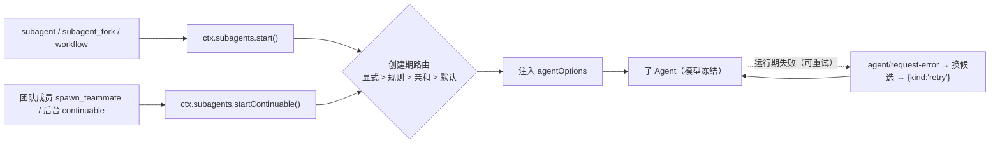
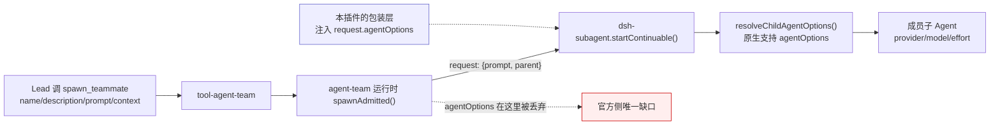

# dsh-team-member-model

给 DSH 的**子 agent 与团队成员**做**模型路由与团队模型管理**：一处配置「谁跑哪个模型」，创建时按 5 级严格优先级（`已存覆盖` > `创建显式` > `默认快照` > `自动规则` > `官方继承`）决定，运行期失败按候选顺序回退（手动固定路线绝不回退）；同时提供官方 Agent Teams 会话顶栏的**团队模型设置弹出菜单**（统一共享草稿、双主按钮、未来默认只读与恢复继承、成员卡片独立自动保存）。
Lead 自己的模型永不参与路由与拦截。

> 作者：hwj ｜ 目标：DSH `0.2.2-rc.3` 及以上（web / desktop profile）
> 版本：`0.7.12`（管理于 `package.json`）
> 0.7.12 rc.3 开发及本地验收记录见 `artifacts/rc3-compat-2026-11-17/`；安装与 GUI 仍需另行核验。
> 路由模型与 5 级优先级架构设计：见 [`docs/spec.md`](docs/spec.md)。

## 0.7.12：DSH rc.3 投影与成员关系适配

目标运行时为 DSH `0.2.2-rc.3` 或更高版本，包声明 `engines.dsh >=0.2.2-rc.3`；旧版宿主不应强制豁免安装。Host 适配使用公开 `subagents.rootOf`、`listDescendants` 和 `startActivation`，以会话 ID 而非同名标签识别成员；创建时预约默认模型快照，无默认时保存 null，避免未来默认回填既有成员。界面的 current 代表最近实际请求，next 代表之后生效的选择；当前轮不中途切换。

Client 根据已加载的 `subagentCatalog` 以 ID 反向寻根，投影缺失、循环或多父冲突时不展示入口，由 Host 做最终身份与活动名单校验。弹出菜单继续使用 Portal，并排除窗口拖动区；未激活的冷成员仅供查看，不会因查看而恢复。SDK 测试使用离线适配器，不连接真实模型网络；发布归档不包含测试文件。安装与 GUI 效果仍需另行核验。

## 0.7.11：请求阶段只读与准备后设置变更回归

0.7.10 的手动覆盖分支仍残留请求期 `select` / `replaceRoute`，此前“彻底消除冲突”的结论不成立。0.7.11 删除该入口：模型选择仅在准备前完成，请求阶段保持原始配置并按实际模型记账。

- 真实 ASAR SDK 用例：`preStep` 锁定 Gemini Flash 后，同轮通过生产 HTTP API 连续修改成员模型与档位；当前请求与同一步骤重试仍为 Flash，同轮重复 claim 不重新选择，下一轮才使用最后保存的 Argon High。
- 同一用例在归档 0.7.10 上复现原始 `after step preparation fixed` 错误，在当前代码通过；没有关闭或削弱官方守卫。
- 同步准备时认领创建计划，保留创建规则的候选链；同一步骤重复失败不能把尚未运行的下一候选记为失败，只有成功提交回复才清除休息状态。
- 新鲜全量运行器汇总：119 pass / 0 fail / 0 skipped（部分脚本内部还包含独立断言计数）；见 `artifacts/request-boundary-2026-11-13/release-tests.log`。未发送付费模型请求。

## 0.7.10：模型准备生命周期对齐与延迟回退（历史记录；遗漏已由 0.7.11 修正）

在 DSH 运行中，若在请求阶段（`agent/request`）临时覆盖配置，会触发官方 AgentLoop 的准备冲突报错（例如：`agent/request proposed "..." after step preparation fixed "..."; use agent.model.select() before step preparation`）。

经审计官方 DSH AgentLoop 真实生命周期契约：
1. **步骤准备期（preStep / inbox.claim）**：AgentLoop 在消息消费后同步读取 `selection = agent.model.current()`，以此锁定当前 step 的模型配置、适配器及上下文。
2. **请求准备期（prepareRequest）**：执行 `agent/request` waterfall 钩子，并**严格断言**提出的配置必须与准备阶段锁定的模型/档位完全一致，禁止任何请求期偷换。
3. **重试机制（AgentLoop retry）**：官方 SDK 仅支持**同 step 同模型重试**（如网络抖动原样重试），不支持在当前 step 内跨模型切换。

**0.7.10 架构与生命周期落地与实测证据**：
- **准备前正式选择**：主路由统一迁移至 `agent/created`（serial 等待异步初始化）与 `agent/inbox/claimed`（同步消息消费后、step 模型 snapshot 之前，带 per-turn guard），通过官方规范的 `agent.model.select(selection)` 写入当前轮模型（避开 `session/event` 中 `turn/start` 可能存在的提交重入）；`agent/request` 阶段严格保持一致，不再在请求期强行修改 `provider/model/reasoningEffort`，彻底消除准备与请求冲突。
- **冷恢复继承基线修复**：修复冷重开时直接从 `agent.model.current()` 继承导致历史 manual override 污染继承底线的缺陷，确立以 SDK 原始 options 为基准，清除覆盖后可精准回退到 Lead 继承底线。
- **自动候选延迟回退（Deferred Failover）**：当自动规划（第 4 级）的模型在运行期发生可重试错误（408/429/5xx、超时、限流等）时，本插件推进失败候选的 rest 休息阶梯与限流沉底，记录 `trace deferred`，将当前 step 的错误如实交给官方 AgentLoop 处理（调用官方 `next()`），并在下一个 turn 的消息认领与步骤准备前自动选择候选链上的后续可用模型。
- **明确边界：这不是旧版同 step 跨模型自动恢复**。本插件绝不拦截当前 step 强行切模、不自动重发、不伪造合成消息；当前 step 的失败如实向官方与用户呈现。
- **不变量保持**：手动前三级（`memberoverride` > `createexplicit` > `captureddefault`）依然严格不回退；5 级优先级严格判定不变；当轮不切换、次轮生效不变；Lead 绝不参与路由与拦截。
- **实测证据**：全量测试套件共 18 个测试文件（包含真实 ASAR 内核 `test/model-preparation-real.mjs` 与 `test/review-model-preparation.mjs`），**全部 117/117 用例通过（0 fail, 0 skipped）**，详细日志归档于 `artifacts/model-preparation-2026-11-06/final-tests.log`。

## 0.7.9：菜单 Portal 逃逸祖先容器裁切

新版 DSH（0.2.2-rc.1）会话顶栏 `conversation.session.header.actions` 祖先容器带有 `overflow: clip` 与 `mask-image`。0.7.8 菜单原在槽内 inline 渲染，导致弹出层被直接裁切不可见。0.7.9 改用 `react-dom.createPortal` 挂载至 `document.body`，彻底逃逸祖先裁切，恢复菜单可见性与交互（支持 Esc 键、外部点击及二次点击齿轮关闭）。

## 0.7.8：改用独立 RPC channel（与官方 Gateway 共存）

0.7.7 换上 `team-member-model/<op>` 后，真实运行里仍报 `/api/team-member-model/teams: HTTP 404`。真因是**通道槽位**而不是
namespace 或鉴权：官方 `connection.rpc.intercept('/api', …)` 是**单槽**（`interceptors` 只存一个，重复注册直接抛
`shared RPC channel "/api" already has an interceptor`），而官方 `@deepseek-ai/dsh-api-gateway` 在
`ctx.inject(['connection'])` 里早就占了这一槽。插件原来的 `rpc.intercept('/api', …)` 于是必然抛错、被 warn 吞掉，
我们的 endpoint 在 carrier 里没有归属 → `not found` 404（页面辅助文案「Host 半侧可能未加载」只是对 404 的推断，不是事实）。

0.7.8 改成**自己的 channel**，不再抢 `/api`：

- Host：channel 常量 `/dsh-team-member-model`；优先试官方 `connection.rpc.handle(channel, handler)`，该 SDK 上若因
  fiber 作用域抛 `cannot get property "webServer" without inject`，则自动退回「本插件挂 `prefix:/dsh-team-member-model`
  + 官方 `connection.admit({ headers })` 鉴权 + 官方 client-request/server-response envelope」的同 channel 方案——
  两条路都不伪造认证、业务仍全部走同一份 `executeApi`。
- 注册用 `ctx.inject(['connection', 'webServer'], child => …)` 建一个只负责远程 RPC 的子 fiber：connection 晚到、
  被替换或插件热重载时自动重注册；disposer 交回 Cordis。注册真失败会写 Host error，不再「warn 一次静默 404」，
  也不会把整个插件（工具/路由/用量）一起挂起。
- Client：`rpc.call('/dsh-team-member-model', 'team-member-model/<op>', payload)`，endpoint 名与 payload、CAS、
  写标记头、Lead/跨团队授权、`executeApi` 业务全部不变。
- HTTP 接口**完全不变**：仍是 `/api/dsh-team-member-model/*`（GET/PUT + `x-dsh-team-member-model: 1`）。

升级要求：**Host 与 Client 一起换 0.7.8 并刷新页面**重载 Client 模块；远端 Host 同样要更新。0.7.6 / 0.7.7 的远程
设置不可靠（前者 405、后者被 Gateway 占槽 404），不再推荐。真实隔离实例上的共存/读写证据见
`docs/superpowers/verification/2026-10-29-rpc-channel.md`；未在真实 SSH/公网远端环境端到端验证。

## 0.7.7：修掉远程 RPC 的 405（历史：远程仍 404，见 0.7.8）

0.7.6 在真实浏览器里报 `transport failure for /api/dsh-team-member-model/teams: HTTP 405`。根因不在鉴权也不在业务：
官方 `webServer` 的路由是**最长 prefix 优先**（`dsh-host-webserver` 的 `match()`：exact 先查，其次最长 prefix，
匹配条件 `pathname === prefix || pathname.startsWith(prefix + '/')`），而 0.7.6 的 RPC endpoint 自己也叫
`dsh-team-member-model/<op>` —— Client 发出的 `POST /api/dsh-team-member-model/teams` 于是先命中本插件注册的
HTTP prefix `/api/dsh-team-member-model`，POST 落到只认 GET/PUT 的 HTTP 处理器上被判 405，官方 `/api` shared carrier
根本没机会收到。

修法是**只把 RPC namespace 换成 `team-member-model/<op>`**（`team-member-model/state`、`efforts`、`usage`、`teams`、
`savePolicy`、`saveTeam`、`resetUsage`），它的 URL 变成 `/api/team-member-model/*`，既不以旧 HTTP 前缀开头，
也不与 `/api` 互为前缀，于是由官方 carrier 接住。**HTTP 接口地址没有变**（仍是 `/api/dsh-team-member-model/*`，
仍然是 GET/PUT + 写操作标记头），旧的 RPC namespace 也不再兼容：往旧路径 POST 依旧 405，不会 fallback 绕鉴权。

升级要求：**Host 与 Client（页面）都要换到 0.7.7 并刷新页面**重载 Client 模块——只换 Host 或只刷新其中一半，
旧页面缓存会继续用旧 namespace 并收到 405；远端 Host 也要一起更新。未在真实远端浏览器端到端验证过，
细节见 `docs/superpowers/verification/2026-10-29-rpc-405.md`。

## 0.7.6：远程 Host 也能改模型设置（历史：RPC namespace 有 405 缺陷，见 0.7.7）

远程 DSH 会话 / 反代下，设置页与团队菜单改用**官方连接通道**（`connection.rpc.call('/api', 'team-member-model/<op>', payload)`；
0.7.6 当时误用 `dsh-team-member-model/<op>`，与旧 HTTP 前缀重叠导致真实 405，已由 0.7.7 修正），
不再用页面自己拼 `/api`——写操作落到真正连着的 Host，而不是页面 origin 那台。Host 半侧只暴露 7 个精确端点
（`state`/`efforts`/`usage`/`teams`/`savePolicy`/`saveTeam`/`resetUsage`），payload 严格校验、peer 由官方认证后传入，
业务授权 / 团队 CAS / 角色 / 模型目录校验与 HTTP 走同一份 dispatch。

HTTP 侧所有 API 在动作前调用官方 `connection.requestRejection({ headers })`：官方回 401/403 就照原样拒绝；
缺连接鉴权服务的旧 DSH 返回 503 并提示升级（不再是「只允许本机回环」）。manifest 的 `dsh.client.inject` 增加
`@deepseek-ai/dsh-client-connection`；**远程 Host 也要装同版本本插件**，`trustedHosts` 与凭据仍由你现有的 DSH 官方配置决定，
本插件不另造 token、不静默改配置。远程只是「同一个 owner 的连接通路」，不是多用户隔离。

## 0.7.5：紧凑团队表单

服务提供方占满第一行；第二行模型与思考档位约按 3:2 排列，窄容器改为单列，按钮位于下方。

## 0.7.4：移除草稿提示，随包附带模型路由说明（历史）

按用户要求删掉「统一模型设置」第一行的草稿说明文字，该行只剩「服务提供方」并整行靠右；第二行「模型 + 思考档位」与下方双按钮不变。同时把 `docs/model-routing-guide.md`（使用说明）加入安装包，归档文件由 12 个变 13 个。

---

## 0.7.3：批量应用的名单三态与设置面板布局

**修复根因（0.7.2 实测失效）**：0.7.2 的 `TeamAction` 把「官方 `agentTeam` 投影还没就绪」和「投影里确实没有活动队员」都折成 `activeNames = []`，而 `[]` 会让所有队员被判成「未在活动名单内」——成员卡片不可编辑、`应用到当前队员` 零 eligible、点击后一次 PUT 都不发（用户看到的就是"按钮没反应"）。

- **名单三态，绝不合并**：`activeNames === undefined` = 未知（投影未就绪）→ 按 Host 视图的 `phase` 应用，并在面板写明「活动名单未知（官方投影未就绪），按 Host 成员状态应用」；**数组（含 `[]`）= 官方已给出名单** → 严格过滤，空数组就是「当前没有活动队员」，零写入并提示「官方名单里当前没有活动队员，应用不会写入任何人」。
- **Lead 永不作为批量目标**：Host 视图本身已按 `role=teammate` 过滤，客户端 `isEligibleMember` 再挡一次 `role==='lead' || name==='lead'`。
- **每条成功即回读**：每次成员保存后用 Host 返回的新视图刷新列表（否则列表仍显示旧路由，看起来像没生效）；CAS revision 随每条 PUT 递增，无静默重试；零写入/部分失败/未确认各有明确文案。
- **布局按截图**：第一行「说明 + 服务提供方」，第二行「模型 + 思考档位」，双主按钮在下方；思考档位下拉**常驻**，未选模型/读取中/读取失败/模型未公布时置灰并在控件上写明原因，只有模型真公布非空档位才可选用（默认项仍省略 `reasoningEffort`，显示/校验同一 bank）。
- 0.7.2 的「没公布就隐藏」策略被本节取代；历史说明保留在下一节，仅作记录。

> 边界：本轮验证为 VM 内真实组件（真实 `lib/client.js` 单 factory）+ 隔离真 Host handler 的 click→HTTP→readback→下一轮 `resolveTeamRoute`；**未在真实浏览器点击/目视**，`unknown` 分支是机制级结论而非现场观测。

---

## 0.7.2：共享模型设置的「思考档位」下拉（真实 metadata）（历史）

- **位置**：统一模型设置按钮行最右侧、「设为新队员默认」之后；成员卡片的模型选择右侧同样复用同一份档位表。
- **只在模型真公布了档位时出现**：唯一数据源是既有 `GET /api/dsh-team-member-model/efforts?provider=&model=`（Host 侧 `llm.resolveModelInfo().reasoning`，只读、不产生 LLM 调用）；`/state` 的目录里只有 `id`/`name`，没有档位字段。实测 `gemini/gemini-3.8-flash-high` 返回 `{efforts: [], supported: true}` → 不占位；`deepseek-official/deepseek-flash` 公布 `off/low/high/max`（默认 `high`）→ 显示下拉。不从模型名里的 `high` 之类后缀猜档位。
- **显示、回填、校验同源**：三处读同一份 `provider/model` bank；档位没读到、读取中或不在公布列表时，不带未确认的值写入，只给出提示。
- **默认项省略字段**：选「用模型默认」时 PUT 的 `selection` 省略 `reasoningEffort`（空字符串会被 Host 当非法值整份拒绝）。
- 切模型/切 provider 即清旧档位；A→B 的迟到响应按 `provider/model` 分 key 写入，不污染当前选择；保存仍走 `writeGate` 与 CAS revision。含 0.7.1 的技能 `source` 热修复，无功能丢失。

> 边界：本轮只有离线 VM 组件级回归 + 真实 Host metadata 读取；**未安装到当前 profile、未在真实 GUI 复验位置/外观**，需在空闲维护窗口装包并冷重启/刷新后才可见。

---

## 0.7.1：技能 source 元数据热修复

修补运行时注册 `model-routing` 技能遗漏的必需字符串 `source`，避免加载时报 `non-string source`。此前测试未覆盖实际注册出口的此项约束，现已补充类型、非空值、精确来源与卸载 disposer 回归检查。当前 Host 的技能加载已验证；其它会话及重启后的行为尚未验证。建议在空闲维护窗口通过官方插件管理界面升级本地包并按界面提示重启或刷新；急需恢复官方功能时可在界面暂时停用本插件。此热修复不改变团队路由功能。


---

## 0.7.0：整合团队模型设置与单决策入口

0.7.0 将原独立插件 `dsh-agent-team-switchable` 的团队模型管理能力无缝整合进主插件，消除两个插件同时监听 `agent/request` 造成的事件顺序竞争与静默覆盖。

### 核心特性

1. **单一 Host 决策入口（Single Decision Point）与 5 级路由优先级**：
   所有子 agent 与团队成员的调用统一在 Host 侧 `agent/request` 裁决，按严格自顶向下判定：
   - **Level 1: `memberoverride`（已存成员显式覆盖）**：在团队菜单中针对具体队员保存的选择。**手动固定，无自动回退**。`turn > effectiveAfterTurn`（下一轮生效），当轮不打断且不重置当前状态。
   - **Level 2: `createexplicit`（创建期显式指派）**：创建子代理/团队成员时通过参数显式指定的模型（如工具调用 `agentOptions.model` 或暂存路由）。**手动固定，无自动回退**；对 `provider` 与 `model` 进行严格非空校验（空 `{}` 不误判）。
   - **Level 3: `captureddefault`（团队默认创建快照）**：在团队成员创建时刻（`team/member` provisioning 事件）捕获的团队 `defaultModel`。**手动固定，无自动回退**。创建时刻若无默认则持久化记录为 null，绝不被后续新默认污染。
   - **Level 4: `auto`（自动规则引擎）**：未被手动命中的普通子代理与团队成员走 `lib/rules.js` 规则匹配。**仅此层级支持候选链延迟故障转移（Deferred Failover）**：在 `agent/inbox/claimed` 准备前选择模型；若运行期遇到 408/429/5xx 等可重试错误，推进 rest 阶梯与沉底，记录 `trace deferred`，当次错误如实放行给官方，下一轮 turn 自动切到下一候选（明确不是同 step 跨模型伪重试）。当规则未命中但成员表非空时，默认选择首项成员（即使 `failover.enabled = false` 也选首项，仅关闭回退，不落入 inherit）。
   - **Level 5: `inherit`（官方继承兜底）**：路由器未配置（成员表为空且无 match）或通道未开启时走官方原生默认。
   - **Lead 绝对保护**：Lead 自身调用永不修改、永不拦截。

2. **团队顶栏设置弹出菜单（Header Action Slot）**：
   - 注册公共插槽 `conversation.session.header.actions`（order: -19），紧邻官方 Agent Teams 图标。
   - 顶部单组共享草稿选择器（`BulkModelPicker`），选择模型不自动保存。
   - **双主按钮**：
     - **「应用到当前队员」**：仅对点击时刻在队的非 Lead 可执行队员逐人显式保存；**绝不修改未来默认**。
     - **「设为新队员默认」**：仅设置团队未来的 `defaultModel`（之后新增的成员生效）；**绝不修改任何已有队员**。
   - **默认摘要与轻量恢复继承**：只读展示「已保存的新成员默认」，旁边提供「恢复继承」链接按钮（独立于共享草稿有效性，即使已存模型下架也能一键清空恢复为继承）。
   - **成员卡片与独立自动保存**：成员卡片内联显示「最近已使用（actualheader，来自自身真实 request/header config）」与「下轮选择（selected/nextModel）」，卡片内下拉变更**立即独立自动保存单成员**。
   - **并发互斥锁（`writeGate`）**：双主按钮、恢复继承、成员行内保存及菜单关闭拦截共用单层全局锁，同 tick 严格互斥防重入，网络对账期间锁不释放。
   - **重开回填状态机**：全员一致且在目录中 → 回填该值；成员设置分散（mixed）→ 保持空白草稿并明确提示（不假称统一）；无可执行成员但有有效默认 → 回填默认（按钮 1 禁用，按钮 2 可用）；零数据 → 初始为空草稿且两按钮禁用（但仅针对当前草稿未选有效模型时，一旦用户手动选出有效模型，即便没有成员也可点击「设为新队员默认」）。用户手动编辑或目录失效清空后不被轮询冲掉。

3. **原生 WebServer REST 通信**：
   - 前后端通过 `/api/dsh-team-member-model/teams`（GET/PUT）通信，携带 `x-dsh-team-member-model: 1` 防跨站，带 `revision` 乐观锁并发保护。
   - 纯前端内联于 `lib/client.js`，无需额外 build 链，精简注入 `inject = ['slots']`。

---

## 0.3.0：从「成员级指定」升级为「子 agent 路由」

0.2.1 只解决了「团队成员能不能指定模型」。0.3.0 按 magpie 的思路把它做成**路由**
（magpie 的 `Group`/`Rule`：`internal/provider/group.go`、`grouprule.go`、`internal/gateway/{routing,fallback,sink,affinity,trace}.go`）：

| magpie 的概念 | 本插件 | 说明 |
| --- | --- | --- |
| `Group.Members`（有序候选，`provider/model[:effort]`） | 成员表 | 第一项 = 没命中规则时的默认；**档位是身份**——同一模型可两档并存，回退链可「先降档再换模型」 |
| `Group.Rules`（按序，首命中） | 规则表 | 命中决定**首选**，不是白名单；其余成员仍是回退候选 |
| `Group.Pick` / `Off` | 一键换 / 摘除 | 手动模式跳过全部规则；摘除保留位置 |
| `Group.Routing` | `order` / `rotate` / `weight` | magpie 的 `smart`/`usage`/`pace` 依赖配额窗口，DSH 不提供 → 不做 |
| `Group.Sink` | 429 的成员退队尾 | 内存态，重启清空（与 magpie 同） |
| `Group.Affinity` | **仅 fork 通道**粘住上次成员 | 子会话共享父前缀时才有 cache 可保；spawn 系各自独立，交给排序策略轮转 |
| `Group.Match` | 目录通配入候选 | `opencode-go/*` 这类模式自动收成员 |
| `Rule.Time` / `Folders` / `Tokens` / `Effort` / `Images` / `Pause` | 同名条件 | 语义逐条对齐（跨午夜、days 归窗口开始那天、`/a/b` 不吃 `/a/bc`） |
| `Rule.Agents` | `channel`（`spawn`/`fork`）+ `continuable` | **只到这一级**，见下方「命中边界」 |
| `Rule.Intent` + Classifier | 意图分类器（**默认关**） | 开启后每次创建多打一次模型调用，结果按任务文本缓存 |
| 候选人循环 + `failure()` + rest 阶梯 | `agent/request` + `agent/request-error` | 可重试失败换候选；400/401/403/404/413 一律不回退 |
| Route trace + Routing 页 | 决策记录 | 路由不可观测 = 没路由 |
| 网关 / 四协议翻译 / 端口 / 账号池 | — | **不搬**：DSH 在进程内调模型，没有协议面 |

**两条创建通道都被覆盖**（这是全部子 agent 的必经之路）：



三条值得单独说的事实：

- **fork 通道其实支持换模型**：`fork` 与 `spawn` 两个 provider 都声明 `capabilities.agentOptions: true`
  （`dsh-subagent-fork-in-process:37`、`dsh-subagent-spawn-in-process:23`）。官方只是在**工具 schema 层**
  没给 `subagent_fork` 暴露模型参数，服务层是收的。但**默认不纳管 fork**——改了路由，被 fork 的父会话
  前缀就不能复用 KV cache（官方 `dsh-base/cordis.patch.yml:379-392` 就是这么取舍的）；要用得显式打开。
- **Lead 是硬隔离**：回退只处理 `session.header.origin === 'subagent'`（或 `delegationDepth ≥ 1`）的 agent，
  Lead 的 `agent/request` 原样返回 `next()`，失败也原样交回官方循环。
- **注入前两道闸**：provider 未声明 `agentOptions` 能力、或未注册，都**不注入**并记一条 trace
  （退回继承 Lead），不消耗这次创建。

### 配置长什么样

设置页「设置 → 模型路由」可视化编辑；也可以直接写策略文件
（`<DSH_HOME>/team-member-model/policy.json`）或用组合行 `config` 播种：

```jsonc
{
  "version": 3,
  "members": [
    { "provider": "zai-coding-cn", "model": "glm-5.3", "reasoningEffort": "max" },
    { "provider": "zai-coding-cn", "model": "glm-5.3", "reasoningEffort": "low" },
    { "provider": "opencode-go", "model": "deepseek-v4.1-flash" }
  ],
  "rules": [
    { "use": "opencode-go/deepseek-v4.1-flash", "label": "*review*" },
    { "use": "zai-coding-cn/glm-5.3", "folders": ["~/work/acme"], "tokens": 60000 },
    { "use": "opencode-go/deepseek-v4.1-flash", "pause": true, "time": { "from": "09:00", "to": "12:00" } }
  ],
  "pick": null,          // 一键换：填 "provider/model" 即跳过全部规则
  "off": [],             // 临时摘除的成员（位置保留）
  "routing": "order",
  "allowFork": false,
  "failover": { "enabled": true, "patience": 2 },
  "classifier": { "enabled": false, "provider": "zai-coding-cn", "model": "glm-5.3" }
}
```

`policy.json` 读到 0.2.1 的 `{version:1, routes:[...]}` 或组合行的 `allowedModels` 数组会**自动迁移**
（变成成员表 + 空规则），旧配置不丢、不报错。

> ⚠️ **升级行为变化（0.2.1 → 0.3.0）**：0.2.1 里成员表是「白名单」——只在显式指定时管用；
> 0.3.0 里成员表是**候选表**，**非空即表示路由器已启用**，所有子 agent 默认跑第一个成员。
> 所以升级后第一次重启，你原来的白名单会立刻变成「默认路由」。
> 想维持「子 agent 继承 Lead 的模型」：把成员表清空（= 路由器关闭），或用 `pick` 指定你真正想要的那条。
> 设置页在「成员表非空 + 无规则 + 无 pick」时会显式弹出这条提示。

## 它解决什么（0.2.1 的出发点，仍然成立）

官方三个 Agent Teams 插件（runtime / tool / client-ui）都没有把**成员级模型**暴露出来：
`spawn_teammate` 只有 `name / description / prompt / context`，成员一律继承 Lead 会话的路由。

桌面上的那份 `agent-team-new-member-default-*.tgz` 用的是另一条路：**团队默认模型 + 独立 GUI 弹窗**，
代价是把团队日志推到 v4、成员事件推到 v3，并明确写了「装了 v4 日志的团队不能只回滚 bundle」。
本插件走**成员级/路由级显式指定**这条路，并且：

| 维度 | 那份补丁（3 个 tgz） | 本插件 |
| --- | --- | --- |
| 官方文件 | 覆盖 3 个官方包 | **零改动** |
| 日志格式 | 新增 v4 + 成员 v3 | **不变**（v2 原样，双向可读） |
| 关闭方式 | 不能只回滚产物 | 摘掉组合行即可，行为 100% 回到官方 |
| 谁决定模型 | 团队默认（先设后建） | 规则命中（创建时）+ 显式指定（最高优先） |


## 历史机制（旧版官方接口，非 rc.3 当前契约）

官方把管道铺好了，只有中段丢了一个参数：



| 事实 | 出处（asar 内官方包 `lib/index.js`） |
| --- | --- |
| `resolveChildAgentOptions(parent, requested, depth)` 支持按 child 覆盖路由 | dsh-subagent:436-452 |
| `startContinuable(spec)` 读 `spec.request.agentOptions` 并用于建子 Agent | dsh-subagent:1671-1683 |
| 运行时调用时只传 `{prompt, parent}`，丢掉 agentOptions | dsh-experimental-agent-team:573-582 |
| `spawnTeammate(caller, request)` 是公开入口，返回 `{member}` | dsh-experimental-agent-team:1764 |
| roster 已把 `model` 投影进成员行 | dsh-experimental-agent-team:449 |
| 基线 GUI 已在成员行渲染 `· 模型: xxx` | dsh-client-ui-agent-team `lib/client.js`:89,132-134 |

因为 `agentOptions` 是在 **spawn 期**用于 `materialize()` 建子 Agent 的，成员**第一轮**就跑在所选模型上；
又因为 GUI 已经渲染 `model` 投影，成员模型会**自动显示在团队面板**上，本插件不需要写任何 GUI 组件。

### 包装为什么必须绕开 `ctx.subagents`

`ctx.subagents` 拿到的**不是服务本体**，而是 cordis 的 traceable 代理（`src/utils.ts:165-218`）。
这一层有两个陷阱，让「就地改方法」注定失败：

- `set` 把写入落到派生的 shadow 上（`Reflect.set(target, prop, value, shadow)`，:201-212）——target 不变；
- `get` 对每个函数属性**重新包一层**代理（:194-196）——连"读回比对函数身份"都不相等。

所以本插件从反射服务的实现表里取本体（`src/reflect.ts:116-125` 的 `Impl.value`），
在**本体**上挂自有属性遮蔽原型方法，自检也只看本体。另外代理调用时会把 `thisArg` 换成 shadow
（`utils.ts:158-161`），因此包装内部**不能用 `this`**，必须显式 `original.call(service, spec)`。
2026-10-09 首版正是栽在前两点，报「服务对象不可写」。

### 组合包形态（2026-10-09 改造）

本插件以**组合包（bundle）**形态安装，而不是手写 profile 托管块：

| 组成 | 内容 |
| --- | --- |
| `package.json` 的 `dsh.bundle.patch` | `./cordis.patch.yml` —— 这是宿主判定"是不是组合包"的唯一依据 |
| 包内 `cordis.patch.yml` | 声明 insert 条目（id `team-member-model`），随包走 |
| profile 的 `dsh.profile.bundles` | 登记包名，决定该层是否加载 |

宿主启动时遍历 `dsh.profile.bundles`，逐个解析包目录、要求 `dsh.bundle`、把包内 patch 当一层加载
（`dsh-app-boot` 的 `loadProfileDirectory`）。解析不到包或声明不兼容时**只跳过这一层并记录原因**，不会让启动失败。

三个关键事实（都从官方源码核实，不是推测）：

- **「已安装」组的过滤条件是 `(installed || optional || error)`**（`dsh-client-ui-plugin-manager`
  client.js:3342-3344），而 `installed` 的判定是「在 profile 的 `dependencies` 里」。
  所以本包是 **`file:../../local-plugins/team-member-model` 本地依赖**——这正是 dshmarket
  对本地安装的落账方式（`sources.js` 的 `isLocalSpec` / file: 分支）。pnpm 用应用自带的 11.7.0，
  参数与市场一致（`CI=true`、`--no-frozen-lockfile`）。
- **兼容性判定只看 `@deepseek-ai/dsh` / `@deepseek-ai/dsh-*` 前缀的 peer**（`app-boot.js:294`）；
  本包只声明 `@deepseek-ai/cordis`，直接跳过，不会被判不兼容。
- **开关在界面上**：官方插件页「已安装」组渲染 `listBundles()`，开关调 `setBundleEnabled`——
  它直接改 `dsh.profile.bundles` 并**热重载该组合包的行**，所以界面开关通常**不需要重启**。

**编辑循环（2026-10-09 二次实测修正）**：pnpm 的 `file:` 目录依赖靠**硬链接（同 inode）**同步——
原地点写源码时安装副本即刻更新。但两个坑都实测踩过：① pnpm 对「已满足」的依赖**从不重新打包**，
普通 `pnpm install` 不会把源码变化打进去；② 编辑器用「写新文件 + 改名」的原子保存会断链，且普通 install 不补。
因此 `-Action install` 内置**哈希校验 + 自愈**：装完逐文件比对源与安装副本，不一致就自动回收安装目录重装
（pnpm 补装缺失包时从源目录重新打包），仍不一致才报错。
日常流程：**改源码 → `-Action install`（或双击 `1-同步并启用.cmd`）→ 重启 DSH**，同步不再依赖编辑器行为。

## 用 AI 配置路由（0.5.0）

插件自带一个技能 `skills/model-routing/SKILL.md`，Host 半侧启动时会把它注册进 `ctx.skills`（用
`ctx.inject(['skills'], …)` 做可选依赖，技能服务缺席不影响插件）。之后在**任意会话**里说：

> 帮我改一下模型路由：前端样式类的活交给便宜的模型
> 看看哪个模型用得最多
> 为什么这条子任务跑到 glm 上去了

Agent 会加载这个技能，按里面的接口清单走 `GET /state` → 改 JSON → `PUT /policy`（**全量替换**），
并回读核对。技能里写死了三条最容易踩的：**直接改 policy.json 不生效**、规则顺序就是命中优先级、
意图必须先在规则里声明才会被分类器选中。

同一份 SKILL.md 也可以直接复制给没装插件的环境：

```powershell
# 复制到用户级技能目录（Windows）
Copy-Item .\skills\model-routing -Destination $env:USERPROFILE\.agents\skills\ -Recurse
```

## 安装、部署与迁移说明

### 推荐安装方式（官方 GUI 本地包安装）

推荐使用打包好的 `.tgz` 产物进行安装：
```text
artifacts/team-integration-2026-10-26/dsh-team-member-model-0.7.0.tgz
```
安装方式：
1. 打开 DSH 桌面端 / Web 端；
2. 侧栏「插件」→「安装本地包」选择该 `.tgz` 文件（或通过 `plugin_manager` 命令行安装）；
3. 按照提示重载或重启完成生效。

### 从旧插件 `dsh-agent-team-switchable` 迁移说明

若您此前安装了 `dsh-agent-team-switchable`（0.2.x 系列）：
1. **人工停用旧插件**：在空闲维护窗口内，通过 DSH 侧边栏「插件」→「已安装」找到 `dsh-agent-team-switchable` 并关闭开关（或将其卸载）。**本插件绝不会自动修改您的 profile 配置来静默禁用其他插件**。
2. **严禁混用**：新版 0.7.0 已完整集成团队模型管理功能，**严禁将新旧两款插件同时开启**，否则将导致团队设置菜单入口重复、事件监听顺序竞争与路由覆盖冲突。
3. **数据隔离与保留**：
   - 原 `policy.json` 和 `usage.json` 保持不变并继续生效。
   - 团队设置使用全新的独立持久化文件 `<DSH_HOME>/team-member-model/teams.json`。
   - 旧 switchable 的存储（`~/.dsh/storages/agent_team_model_settings.json`）**不会自动扫描或导入**，旧数据完好保留在磁盘上，团队模型设置从干净状态重新开始。

### 历史辅助脚本说明（`team-member-model.ps1` 与 `.cmd`）

- 目录中保留的 `team-member-model.ps1` 及 4 个 `.cmd` 脚本属于**历史遗留辅助脚本**。
- ⚠️ **0.7.0 适用性警告**：旧脚本内的硬编码同步清单仅覆盖早期单文件，**未包含** 0.7.0 新增的 `lib/team-state.js` 与 `lib/team-routing.js` 等模块；直接执行旧脚本会导致新模块缺失从而引发启动故障。**请勿使用这些脚本安装 0.7.0**，推荐统一使用官方 GUI 本地包安装上述 `.tgz`。

---

## 设置页

重启后：**设置 → 模型路由**（Host 侧路由 `/api/dsh-team-member-model/*`，策略落在
`<DSH_HOME>/team-member-model/policy.json`）。

页面分五块，改完点「保存更改」一次提交（PUT `/policy`，带 `x-dsh-team-member-model: 1` 标记头）：

| 区块 | 能做什么 |
| --- | --- |
| 成员表（v4） | **成员 = 固定名字 + 若干渠道绑定**：一个成员可装同模型的多个渠道（顺序 = 渠道优先级，失败先换渠道再换成员）；绑定级可配推理档、停用时段、单独停用；成员级权重/摘除；同模型多渠道可一键合并 |
| 用量 | 三张图：**按成员聚合、点开看每个渠道的明细**（横条 + 调用数/入出 token/缓存读）、最近 24 小时（每小时 token 柱）、规则命中分布；可切换排序、刷新、清零 |
| 规则表 | 新增/排序/删除规则；条件有通道、创建方式、标签通配、成员名通配、意图、目录、目录不含、tokens、推理档、图片、时段；也可勾「停用成员」写成 pause 规则 |
| 路由策略 | 一键换（`pick`）、候选排序（order/rotate/weight）、纳管 fork、运行期回退（开关 + 次数）、意图分类器、目录通配入候选 |
| 决策记录 | 最近 20 条（共 60 条）路由决策：注入/放行/回退/放弃，含命中第几条规则、最终路由、标签 |
| 页脚 | 保存状态 + **Host 半侧状态**（读 `status.json`，这是「页面能开 ≠ 功能可用」的唯一直接证据） |

- 成员表为空 = 路由器关闭，**完全等于官方行为**（不接管任何创建）。
- 目录里没公布 models 的 provider 可以用规则里的「手工 provider/model」输入框直接填——
  官方口径是「目录成员资格仅供参考」，适配器可以接受未公布的 model id。
- 也可以只用组合行 `config` 播种（仅在策略文件缺席时生效，设置页保存过的值优先）：

```yaml
- id: team-member-model
  name: dsh-team-member-model
  config:
    members:
      - { provider: zai-coding-cn, model: glm-5.3 }
      - { provider: opencode-go, model: deepseek-v4.1-flash, reasoningEffort: high }
    rules:
      - { use: opencode-go/deepseek-v4.1-flash, label: '*review*' }
    allowFork: false
    failover: { enabled: true, patience: 2 }
    # 0.2.1 的写法也认：allowedModels: [...] → 成员表
    freshProvider: spawn   # 与官方 tool-agent-team 同名同默认
    forkProvider: fork
```

## 模型怎么用

需要给成员指定模型时，用 `spawn_modeled_teammate`（参数比官方多三个）：

```
spawn_modeled_teammate({
  name: "frontend",
  description: "负责前端页面",
  prompt: "……完整任务……",
  context: "fresh",
  provider: "zai-coding-cn",
  model: "glm-5.3"
})
```

不传 `provider`/`model` 时**完全等价于官方 `spawn_teammate`**（成员继承 Lead 路由）——
也就是说这个工具可以统一替代官方工具，不必在两者之间来回选。

> ⚠️ **工具兼容说明**：0.7.0 完整保留主插件自有的 `spawn_modeled_teammate` 工具。
> 旧 switchable 插件中的 `spawn_teammate_with_model` / `fork_teammate_with_model` 并未合并引入；团队创建与模型绑定推荐直接在会话顶栏「团队模型设置」菜单中配置，或使用 `spawn_modeled_teammate`。

## 降级是安全的

| 情况 | 行为 |
| --- | --- |
| 成员表为空 | 路由器关闭，**完全等于官方行为**（不接管任何创建） |
| 暂存路由没命中（名字/描述对不上） | 原样放行，**完全等于官方行为** |
| 规则都不命中 | 用成员表第一个（`order`），或按选的策略排序 |
| fork 通道且未开 `allowFork` | 不注入，记一条 trace（`fork-disabled`） |
| provider 没声明 `agentOptions` 能力 / 未注册 | 不注入，记一条 trace，子 agent 退回继承 Lead |
| 分类器失败或说不清 | 视为该项条件不命中（绝不让创建失败） |
| 官方改了身份前缀文案 | 匹配失败 → 不注入，成员退回继承路由（可观测，不报错） |
| 工具传了表外的路由 | 工具直接拒绝，**不消耗成员名**（官方创建失败也会永久占名） |
| 包装没挂上（服务对象不可写） | `apply` 直接抛 → 插件清单显示「启动失败」，并写 `status.json` |

## 已知边界

**命中边界（不画饼）**：路由发生在 `subagents.start` / `startContinuable` 这个服务缝隙上，
那里**没有工具名**——官方 `tools/pre-execute` 只能 allow/deny/cancel/ask，
`tools/execute` 的文档明写 call identity 不可改。所以 `channel` 只到「哪个 subagent provider
（`spawn`/`fork`）+ 是否 continuable」这一级，**区分不出 `subagent` 与 `workflow`**（都走 provider `spawn`）；
要更细就用 `label` 通配。`tokens` 条件量的是**父会话当前规模**（`tokenMeter.measure`），
不是「这次请求多长」；`images` 扫的是创建请求的内容块，不是父会话历史里的图。

其余边界：

- **fork 默认不纳管**：改路由会破坏父会话前缀的 KV 复用（官方 base 组合层的取舍）；
  要用得在设置页显式打开，且只有**规则注入**受这个开关约束——`spawn_modeled_teammate` 的显式路由
  在任何情况下都生效（0.2.1 行为不变）。
- **`smart`/`usage`/`pace` 策略不做**：它们依赖 magpie 的配额窗口（`allowances`）数据，DSH 不提供，
  与其编一个假的，不如没有。
- **冷成员的回显**：`list_agents` 对**未加载**的成员回退显示 Lead 的模型（官方 `roster.list()`:449）。
  重启后未唤醒的成员在面板上会显示 Lead 的模型，唤醒后自动正确。本插件刻意不改这一处。
- **两个创建工具并存**：官方 `spawn_teammate` 没有被禁用。它创建的成员同样会走**规则路由**
  （因为路由发生在服务层），只是没有「显式指定」这一档。
- **回退只处理可重试失败**：`status` ∈ {408, 429, 5xx} 或 `code`/`message` 命中超时/过载/网络/限流/额度类。
  400/401/403/404/413/422 这类**请求本身的拒绝一律不回退**（换模型也答不对，只会掩盖错误）。
  每个子 agent 最多切换 `failover.patience` 次（默认 2）。
- **DSH 升级**：官方包升级后若 `start`/`startContinuable` 契约变化，自检会在启动时失败并写 `status.json`；
  `agent/request` 与 `agent/request-error` 按事件名注册，官方若改名则只是**没有回退**，创建期路由不受影响。
- **鉴权**：设置接口只接受回环地址 + 写操作标记头。跨站页面既发不出自定义头（会触发预检，而本路由不答预检），
  也过不了回环检查，因此写路径无需额外 CSRF 令牌；但这仍不是完整的用户级 ACL。
- **页面出现 ≠ 功能可用**：客户端半侧与 Host 半侧**独立加载**。Host 半侧启动失败时设置页照样渲染，
  只是接口 404。判断真实状态看设置页页脚的「Host 半侧」一行（读 `status.json`）。

## 变更记录

| 日期 | 变更 |
| --- | --- |
| 2026-11-06 | **0.7.10：模型准备生命周期对齐与延迟回退（全量验收通过）**：对齐官方 AgentLoop 契约（`preStep` 锁定 selection，`prepareRequest` 严查一致性）；主路由移至 `agent/created` 与 `agent/inbox/claimed`（避开 `turn/start` 重入）并在步骤准备前调用 `agent.model.select()`，请求期不再偷换 config，彻底消除 prepared 与 request 冲突；修复冷恢复清除覆盖回退继承底线缺陷；运行期可重试错误推进 rest 阶梯与沉底并记录 `trace deferred`，下轮 turn 选择下一候选，当前失败如实交官方，明确不作同 step 跨模型伪重试；全套 18 个测试套件 117/117 用例通过（0 fail, 0 skipped）。 |
| 2026-11-05 | **0.7.9：菜单 Portal 逃逸祖先裁切**：修复 DSH 0.2.2-rc.1 会话顶栏祖先带有 `overflow: clip` 与 `mask-image` 导致弹窗被截断不可见的缺陷；`TeamPopup` 改用 `react-dom.createPortal` 挂载至 `document.body`，排除 anchorRef 点击防重复触发，支持 Esc 与外部点击关闭。 |
| 2026-10-27 | **0.7.3：批量应用名单三态 + 面板布局**：修 0.7.2 把「投影未就绪」与「确实没有活动队员」都折成 `[]` 的根因——`undefined`=unknown 按 Host `phase` 应用、数组含 `[]`=已知名单严格过滤且零写入并提示；Lead 永不作为目标；批量每条成功后立即回读视图，CAS 逐条递增，零写入/失败/未确认分别明说；布局改为「说明+provider / model+思考档位 / 双按钮底部」，思考档位常驻、未就绪置灰并写明原因（默认项仍省略字段）。测试 8 文件 56 TAP 全绿。 |
| 2026-10-27 | **0.7.2：思考档位选择器（真实 metadata）**：共享模型设置按钮行右侧新增「思考档位」下拉，成员卡片复用同一份 `provider/model` bank。数据源为既有 `GET /efforts` 的真实 `reasoning.efforts`（`/state` 目录不含档位，根因即此前读空列表），模型未公布即不占位、绝不从名字猜；显示/回填/校验同源，未确认档位禁止写入，默认项省略 `reasoningEffort`；含 0.7.1 技能 `source` 修复。全量测试 8 文件 50 TAP 全绿。 |
| 2026-10-26 | **0.7.0：整合团队模型设置与单决策入口**：将 `dsh-agent-team-switchable` 的团队模型管理能力无缝整合进主插件。构建单一 `agent/request` 决策入口，确立 5 级严格路由优先级（`memberoverride` > `createexplicit` > `captureddefault` > `auto` > `inherit`），手动固定路线绝不回退，仅自动规则可回退；Lead 绝对保护；团队成员修改下一轮生效当轮不打断。新增官方会话顶栏团队模型设置弹出菜单（`conversation.session.header.actions` order: -19），单组共享草稿、双主按钮（应用到当前队员 / 设为新队员默认）、只读默认摘要与恢复继承、成员卡片独立自动保存、全局互斥锁 `writeGate` 与重开回填状态机。通过 `/api/dsh-team-member-model/teams` REST 接口通信；新持久化文件 `teams.json`（全局 Promise 队列原子落盘），旧数据不自动导入。全量自动化测试扩充至 7 个文件 142 项断言全部通过。 |
| 2026-10-26 | **0.6.1 打包分发（发给朋友的可移植 zip）**：清单按「安装脚本真正读取的文件」定——4 个 `.cmd`、`team-member-model.ps1`、`package.json`、`cordis.patch.yml`、`lib/` 五个 js、`skills/model-routing/SKILL.md`、`docs/spec.md`、`README.md`、`给测试者.md`、`test/` 三份；zip 根目录是 `dsh-team-member-model/`，解压即一个文件夹。`team-member-model.ps1` 改为 **UTF-8 带 BOM**：没有 pwsh 时 `.cmd` 会回退 powershell 5.1，而无 BOM 的 UTF-8 脚本会被按 ANSI 解析，中文提示全乱码（已用 5.1 实测：解析 0 错误、中文正常）。修 `-Action status` 的「白名单  条」空值——0.6.x 的 `status.json` 只写 `members`/`bindings`/`rules`，改按新键显示并把时间转本地（5.1 下 `at` 仍是字符串，走原样显示）。顺手把《给测试者.md》按 0.6.1 重写（设置页名是「模型路由」而非旧的「团队成员模型」、成员=名字+渠道绑定、109 项测试），并清点测试段项数（41→43、28→29） |
| 2026-10-16 | **0.3.0：子 agent 模型路由**。按 magpie 的 Group/Rule 语义新增：成员表（有序候选）、规则表（10 类条件，首命中决定首选）、一键换 `pick`、摘除 `off`、排序策略 order/rotate/weight、目录通配入候选 `match`、父会话亲和、运行期回退（`agent/request` + `agent/request-error`，含 rest 阶梯/`served` 清 rest/429 sink/可重试白名单）、意图分类器（默认关）、决策记录与全新的路由设置页。覆盖**两条创建通道**（`startContinuable` + `start`）——后者等于把 `subagent`、`subagent_fork`、workflow 的每次 `agent()` 都纳入路由。契约依据、magpie 1:1 映射与不搬清单见 `docs/spec.md` |
| 2026-10-16 | **修 pause 语义（被测试抓出）**：首版 `normalizeRule` 把 pause 规则的 `use` 丢掉了，于是它退化成「全停用」开关；magpie 的 `Pause` 是「条件成立时摘掉 Use 命名的那个成员」。改为 pause 同样必须点名成员，并补回归测试 |
| 2026-10-16 | **修卸载残留（被测试抓出）**：包装还原时直接赋值 `original`，会在服务本体上永久留下一个自有属性遮蔽原型方法。改为记住 `Object.hasOwn`，原本在原型上就 `delete`（恢复 0.2.1 的「完全还原」契约） |
| 2026-10-16 | **修页面把纯空白当有效值**：设置页原来会把 `label: "   "` 原样发给 Host，Host 以「必须是非空字符串」整份拒绝保存，用户在页面上只看到一句对不上输入框的报错。改为页面侧先 trim、空白即视为未填 |
| 2026-10-20 | 用量面板细分到渠道（用户要求「可以按成员聚合，但还是要能细到渠道模型」）：成员行可点开，展开后每个渠道一行（各自的入/出/缓存 token、调用数、相对同成员其它渠道的条形）——数据层本来就有 `/usage.bindings`，这次把它显式做成两层视图 |
| 2026-10-20 | **0.6.1：兼容 DSH 0.2.1-rc.2 的 subagent 新 API**（用户把插件迁到 Windows 桌面版后插件 `fiberPhase: failed`，`status.json` 报「ctx.subagents 既没有 start 也没有 startContinuable」）。0.2.1-rc.2 把创建入口从 `start(name, request)` / `startContinuable(spec)` 改成了 **`startExternal(spec)` / `startLocal(spec)`**（注入点仍是 `spec.request.agentOptions`）。现在 `installWrapper` 自动识别两代 API，同一份代码在 0.2.0-rc.2（WSL）与 0.2.1-rc.2（Windows 桌面版）都能包装；`rawService` 的识别方法名支持数组。顺带修掉 Windows 上的 `~` 展开 bug：`USERPROFILE` 带反斜杠，`~/proj` 规则此前会静默失配 |
| 2026-10-20 | **0.6.0：成员 = 逻辑名 + 渠道绑定（schema v4）**（用户提出「很多模型是一样的、只是渠道不同」）。原来「一个渠道×模型 = 一个成员」，规则直接绑死渠道；现在成员是**固定名字**，内部装若干「渠道×模型」绑定：规则只引用成员名（换渠道/换模型 id 不用动规则），运行期回退阶梯变成**先同模型换渠道、再换成员**，渠道级能力（推理档、高峰停用时段、单独停用）挂在**绑定**上，任务类条件挂在**规则**上。**v3 自动迁移且零行为变化**：旧成员变成「名字 = 旧身份、内含一个绑定」，现有规则不用改；规则里写旧绑定键也能解析到成员。界面支持成员内增删/排序绑定、绑定级时段与停用、同模型多渠道一键合并（规则引用一并改写）。测试 106 项（37/41/28），其中新增跨渠道回退、绑定时间窗、合并建议、成员校验用例 |
| 2026-10-20 | **0.5.0：随包技能 `model-routing`**（用户要求「方便用户通过 AI 配置路由」）：`skills/model-routing/SKILL.md` 作为唯一事实源，Host 启动时经 `ctx.inject(['skills'], …)` 注册进技能目录——可选依赖、读不到文件也不影响插件启动。技能内容含：接口清单（/state /efforts /usage /policy）、策略 schema 与成员身份语法、命中顺序与优先级语义、改配置的标准流程（GET→改→PUT→回读）、6 个常用配方（换模型/分档/省钱/一键全换/排错/看用量）、边界与红线。另新增 `lib/skill.js`（最小 frontmatter 解析）；安装脚本自检扩到 8 个关键文件 |
| 2026-10-20 | **前端任务按性质分档**（用户要求）：原来的「前端界面与交互实现」一刀切到 v4.1:max，把「调边距/改文案」这类活也抬到了 max 档。拆成两条互斥意图——**前端功能开发**（页面/组件/交互逻辑/状态）→ v4.1:max，**前端样式微调**（CSS/间距/颜色/字号/文案）→ gemini-3.8-flash。意图标签刻意用短文（不带括号说明）：解析是「答案包含意图原文」，带括号的长标签一旦模型只回半句就匹配失败、退回默认。前端相关但属于别的性质的活不受影响：联调接口→接口与集成设计、bug 修复→缺陷修复、性能优化→性能与资源优化（都在 v4.1:max），带图→gemini-3.8-flash-high |
| 2026-10-19 | **规则瘦身：78 → 22 条**（用户指出「配了意图就没必要这么多词条」）：57 条关键词规则与意图规则是同一套场景的两种写法，等于同一件事维护两处——模型一换（如 gemini 下架）关键词要改 12 条，意图只要改 4 条。逐条对完覆盖关系后全删关键词，补 1 条「部署与环境问题处理」意图（关键词组里唯一没被意图覆盖的场景），现在只剩 **1 条带图 + 20 条意图 + 1 条兜底**。代价要说清：以前关键词命中就不调分类器，现在**每次创建都会调一次**（便宜模型 + 按任务文本缓存）；换来的是一处维护、语义分类能接住同义说法 |
| 2026-10-19 | **补 19 条「意图」规则**（用户要求）：分类器从互斥的意图词表里选一个，规则按意图分流——判断类（代码审查/对抗挑刺/安全审查）→ glm-5.3:max；起草类（方案设计/缺陷修复/重构/测试编写/数据库取数/前端界面/接口设计/性能优化）→ v4.1:max；轻分析（日志报错/代码定位/数据核对）→ mimo-flash；调研选型 → mimo-pro；机械（翻译/格式化/文档/造数据）→ gemini-3.8-flash。**顺序语义**：58 条关键词规则在前、19 条意图规则在后、兜底最后——标签精确命中优先，意图只捞漏网的；分类器说不清（intent=null）时退回原行为（一次性→v4.1 默认档，团队成员→权重轮转）。决策记录里现在会显示「意图 X」，用来判断分类器判得准不准 |
| 2026-10-19 | **修「意图分类器无法保存、刷新就丢」**（用户实报）：根因是客户端的一条硬拦截——「开了分类器但 provider/model 没填全」直接**拒绝整份策略提交**，于是一个字节都没发出去，别处的改动跟着一起丢，而提示只在底部栏一闪。改为**保存照发**（Host 本来就接受这种配置，只是意图条件不命中），并在字段旁常驻提示「没填全 → 意图条件不会命中」；新增回归用例：只填 provider 也必须发出 PUT 且请求体带上它 |
| 2026-10-19 | **0.4.0：用量统计**（用户要求「不然很难一眼看出模型使用情况」）。新增 `lib/usage.js`（纯函数聚合）+ 宿主侧 `session/event` 监听：按官方 `assistant/message.usage` 口径累计（只在**成功提交**的锚点计数、同 `(turn,step)` 去重、适配器没报 usage 不算调用），四类 token 互不重叠地累加；归属用「子会话 → 实际跑的成员」，规则命中还记到具体规则（图 3）。落盘 `usage.json`（节流 15s，重启不清零），接口 `GET /usage` 与 `PUT /usage/reset`。设置页加「用量」面板：按成员横条（可切总 token/调用次数/输出 token）、最近 24 小时柱状、规则命中分布——全部手绘 CSS，不引图表库。**只统计子 agent，Lead 不计**（用户明确） |
| 2026-10-19 | 模型替换：`gemnin` 的 `gemini-3.1-pro` / `gemini-3.1-flash-lite` 已下架，按目录换成 `gemini-3.8-flash-high` / `gemini-3.8-flash`（成员 2 个 + 规则 12 条引用，零残留） |
| 2026-10-19 | **修白屏 + 恢复详细配置项**（用户实报）：分组视图抽取编辑器时残留了 `ruleItems.push(`，点「新增条件规则」在渲染期抛 `ReferenceError: ruleItems is not defined` → 整页白屏；同时关键词胶囊只能删不能编辑，等于把通道/目录/时段等详细配置项藏了。现在**点胶囊即展开该规则的完整编辑器**。新增 `test/client.mjs` 的**交互测试台**：在假 React 里真跑组件体、按标签触发 onClick 再重渲染——这类「渲染期抛错 = 白屏」的 bug 静态断言抓不到，必须真点一遍 |
| 2026-10-19 | **规则面板改成分组视图**（用户反馈：规则多了之后很难看）：按目标成员分组渲染，纯关键词规则显示为**胶囊**（点 × 删、组内输入框回车加），带其它条件（通道/目录/时段/图片/兜底）的规则保留完整编辑器。59 条规则从 59 行变成 6 张卡片。加关键词的插入位置由 `keywordInsertIndex` 计算——必须落在兜底规则（continuable/pause）之前，否则新词永远命不中 |
| 2026-10-19 | **补全开发场景规则表**（59 条）：判断类（review/审查/审核/评审/安全/漏洞/对抗/红队/挑刺/反驳/critique）→ glm-5.3:max；起草类（计划/方案/排查/部署/修复/重构/写测试/SQL/报表/页面/组件/接口/优化…）→ v4.1:max；调研 → mimo-pro；轻分析（日志/报错/堆栈/定位/核对）→ mimo-flash；机械（翻译/格式化/重命名/mock/文档/总结）→ gemini-lite。并按用户原则重定分工：**生成用够强的（v4.1:max 起草），判断用更强的（glm:max 审核/对抗——只有高模型才能审核低模型）** |
| 2026-10-16 | **推理档进成员身份**（magpie 的 `provider/model[:effort]`，用户拍板）：同一个模型可以以不同档位作为两个成员入表、各带权重；规则 `use` / `pick` / `off` / `pause` 全部按完整身份解析（`zai/glm-5.3:low` 只命中 `:low`，不误领 `:max`）；rest / sink / 亲和也按档位记账（`:max` 休息不影响 `:low`）；回退链因此能表达「先降档（同模型，上下文兼容）再换模型」。连带修一个认领坑：一次性子代理的回退计划按成员身份记账，认领键要先试带档位再退回裸键，否则档位成员的子代理永远认领不到；再加**裸引用自动迁移**——老写法 `use: "p/m"` 在表里只剩一个档位变体时自动升级成 `p/m:effort`（不升级会静默丢档位：审查规则从 max 悄悄掉回默认档），同模型有两个变体时存在歧义、保持原样等用户显式写 |
| 2026-10-16 | **修「weight 全部没生效」**（用户实报）：根因是亲和写宽了——「同一父会话粘住上次成员」被用在了**所有**创建通道上，于是 Lead 会话创建第一个子 agent 之后，后面每一个都粘在那个成员，weight/rotate 永远轮不起来。亲和只在 **fork 通道**（子会话真的共享父会话前缀）才有意义，spawn 系各自独立会话、没有前缀可共享。连带发现旧测试靠这个 bug「巧合」通过（父会话亲和把 rest 中的成员强行拉回首选，掩盖了 restLast 的降序），已改为规则点名的确定性写法；`putPolicy` 也加了状态码断言，静默失败不再让后续用例拿旧策略瞎跑 |
| 2026-10-16 | **意图分类器的 provider/model 改成下拉**（用户要求，与推理档同口径）：选项来自模型目录（就是「添加成员」用的那份，不新增接口），换 provider 自动清掉 model 重选；当前值不在目录里时**保留成一项**而不是悄悄清空（select 渲染即丢值的坑）；目录为空才给手填入口 |
| 2026-10-16 | **修保存成功后的回填崩溃**（用户实报 `Cannot read properties of undefined (reading 'join')`）：上一条「空值不送字段」的修改有个漏网消费者——`save()` 成功回调里的 `body.match.join(", ")`。保存其实已成功，炸的是保存后的界面回填。提成 `matchTextOf()` 纯函数并对空值兜底，加回归测试 |
| 2026-10-16 | **修「保存报错：策略：match 若给出必须是非空数组」**（用户实报）：设置页在「目录通配自动入候选」为空时仍送 `match: []`，而校验把「给了就必须非空」当规则。改为**空数组/空串一律按「没给这个条件」**（`match`、规则里的 `folders`/`exceptFolders`、分类器的 `provider`/`model` 同一口径），客户端也不再送空字段；非数组、含空串仍然拒绝。另加保存前本地校验：pause 规则没选成员、开了分类器没填 provider/model 都在页面上直接说清，不推给 Host |
| 2026-10-16 | **混合版本状态自检**（用户实报 `unknown action: .../policy` + `/efforts` 405）：客户端半侧刷新即新版，而 Host 半侧只在**进程启动**时求值模块——于是界面是新的、接口是旧的。页面现在识别 0.2.1 的 `/state` 形状并显式报出「Host 半侧还是旧版本，请重启 DSH」，同时**禁用保存**且不降级去写 `/routes`（那会把 v3 的规则等字段抹成 v1）。实测确认：界面开关的热重载会重跑 `apply()`，但 **ESM 缓存按路径命中、改过的文件不会重新求值**，所以代码变更只能重启进程 |
| 2026-10-16 | **推理档改成下拉**（用户反馈「手动填不知道填什么」）：数据源是官方 `llm.resolveModelInfo(provider, model).reasoning.efforts`（真机实测 `zai-coding-cn/glm-5.3` 只认 `low`/`high`/`max`，且无默认档）。新增 Host 侧 `GET /efforts`（懒加载 + 5 分钟缓存），成员编辑器按模型公布项渲染下拉、标出默认档、保留未公布的手工值，并在字段下方说明「该模型公布了哪几档」；模型没公布或解析失败时才给手填入口 |
| 2026-10-16 | **rest 阶梯对齐 magpie**（用户比对后指出）：原来 429 无 Retry-After 固定 30 秒，而 magpie 是「1 分钟起、每次翻倍、封顶 30 分钟（longestRateRest）」，普通失败封顶 10 分钟（longestRetry），额度/余额用尽直接 30 分钟。已按 magpie 重写 `restDelayMs` 并加断言 |
| 2026-10-16 | **设置页重做**（用户反馈「密密麻麻、不好用」）：规则/成员改成「一行摘要 + 点开才出表单」，字段全部带可见 label（不再靠 placeholder 认字段），高级项与决策记录折成原生 `<details>`，底部加粘性保存栏，图标换成自绘 SVG，配色只用主题里真实存在的 token（清掉 `--dsw-alias-state-warning-primary` 这类不存在的名字） |
| 2026-10-16 | 安装脚本的哈希自检从「四个关键文件」扩到**五个**（加 `lib/rules.js`）：少比一个「改了就会改变行为」的文件，硬链接断掉时就会「装完看着成功、真机还是旧逻辑」 |
| 2026-10-09 | 首版：工具 + `startContinuable` 包装 + 白名单设置页 + 双半侧安装脚本 |
| 2026-10-09 | 修 Host 半侧启动失败：组合行不写 `config` 时误把 `allowedModels: undefined` 当非法输入抛出，导致路由未注册、设置页 404（`status.json` 记下现场）。新增 `resolveSeed()` 与回归测试 |
| 2026-10-09 | 成功时也写 `status.json`（`mode: ok`）：这是区分「页面能开」与「工具/路由真的注册上了」的唯一直接证据 |
| 2026-10-09 | 设置页改版：自动带出模型目录 → 按 provider 分组勾选增删，支持搜索、整组全选/清空、手工补路由 |
| 2026-10-09 | 包装加原型级回退：实例级赋值被宿主拦截时改在原型上覆盖（`status.json` 记录 `wrapper: instance/prototype`），把「一次重启就成」的概率拉满；新增 16 项假宿主端到端测试 |
| 2026-10-09 | **修 Host 半侧启动失败（真机第二次）**：`ctx.subagents` 是 cordis traceable 代理，`set` 把写入丢给 shadow、`get` 重新包装函数，导致包装既不生效也比不出真假。改为从 `ctx.reflect` 实现表取服务本体、在本体上挂自有属性，包装内显式绑 `this`。假宿主改为**忠实复刻这两个陷阱**，测试从 16 → 18 项（原来"善良的假宿主"正是漏掉这个 bug 的原因） |
| 2026-10-09 | 安装脚本加 `enable` / `disable`：本插件是 profile 组合行，市场页与内置插件页都没有它的开关，只能改托管行的 `disabled` |
| 2026-10-09 | **改造为组合包形态**（按用户要求"参考插件市场的做法"）：包内加 `dsh.bundle` 声明 + `cordis.patch.yml`，登记进 profile 的 `dsh.profile.bundles`，清掉手写托管块。开关从此在「插件 → 已安装」里，且 `setBundleEnabled` 会热重载、通常无需重启。**刻意不做 pnpm 依赖**——`resolveBundleDir` 只要求包可解析，因此不碰 `dependencies` 与锁文件 |
| 2026-10-09 | **修设置页样式**：CSS 只定义没注入 `document.head`（ModuleLoader 的 factory 不会自动带样式），页面全是浏览器默认样式。补上 `<style>` 注入（`data-plugin-css` 去重）并重做排版：模型 id 占满剩余宽度可省略、显示名靠右次要色、选中行左侧强调条、分组计数 pill、hover/focus 态。新增 `test/client.mjs`（node:vm 真跑客户端半侧，6 项）防止再犯 |
| 2026-10-09 | **修「已安装」组不显示卡片**：客户端过滤是 `(installed \|\| optional \|\| error)`（`dsh-client-ui-plugin-manager` client.js:3342-3344），非依赖组合包三不占、整卡被滤掉——上一版"不碰 pnpm"的捷径到这里走不通。改为 **`file:../../local-plugins/team-member-model` 本地依赖**（dshmarket 对本地安装的落账方式），用应用自带 pnpm 11.7.0 + 市场同款参数（`CI=true`、`--no-frozen-lockfile`）安装。实测 `file:` 目录依赖是**硬链接（同 inode）**：改源码即生效，编辑循环就是「改代码 → 重启」，日常连 install 都不用跑；若某编辑器用"写新文件+改名"断开了链接，重跑 `-Action install` 即重新链接 |
| 2026-10-09 | **真机实测通过**。Lead=zai/glm-5.3 下：官方 `spawn_teammate` 的成员 descriptor 记 `zai-coding-cn/glm-5.3/effort=max`（继承）；`spawn_modeled_teammate` 指定 opencode 路由的成员记 `opencode-go/deepseek-v4.1-flash`（注入生效，且因换路由自动清空继承 effort——官方 `resolveChildAgentOptions` 的文档化语义）。证据取自**官方运行时自己持久化**的 subagent descriptor（成员会话日志，zstd 多帧按魔数切分解压）。已知显示边界同时被现场证实：`list_agents` 对**已卸载**成员回退显示 Lead 模型（官方 `roster.list()` 行为），运行中显示正确 |
| 2026-10-09 | **修设置页「保存一次候选全消失」**：`PUT /routes` 响应只带 routes 不带 catalog（Host 刻意不再拉目录），但 `save()` 拿响应体直接算状态，`payload.catalog \|\| []` 把已加载目录覆盖成空。改为响应不带目录时沿用本次已加载的目录；`applyPayload` 提到组件外并导出（`_applyPayload`）加了 3 条回归测试（客户端测试 6 → 9 项） |
| 2026-10-09 | **修正编辑循环语义 + install 自愈**：此前"重跑 install 即重新链接"是错的——pnpm 对已满足依赖从不重新打包，`file:` 依赖内容同步完全靠硬链接 inode，编辑器原子保存断链后普通 install 不补。`install` 现在内置哈希校验：不一致自动回收安装目录重装（补装缺失包触发从源目录重新打包），仍不一致才报错 |
| 2026-10-09 | **0.2.1 打包分发（可移植化）**：node/pnpm 改为候选链自动探测（PATH→NVM→Program Files，pnpm 走 `%LOCALAPPDATA%`/`%ProgramFiles%` 的 DSH 安装位，均可 `-NodePath`/`-PnpmPath` 覆盖，node 强制 ≥18 以跳过 PATH 上的老版本）；`file:` 依赖 spec 从**脚本实际位置**动态计算（解压到任意目录可装，移动后自动改写指向，全量可移植性实测两阶段通过）；无本机回收工具时退化为同目录改名隔离（不永久删除）；spec 改写后首遍 pnpm 可能只更锁文件不落包，加一次自动重试；新增《给测试者.md》 |
| 2026-10-09 | 修 Host 半侧启动失败：组合行不写 `config` 时误把 `allowedModels: undefined` 当非法输入抛出，导致路由未注册、设置页 404（`status.json` 记下现场）。新增 `resolveSeed()` 与回归测试 |
| 2026-10-09 | 成功时也写 `status.json`（`mode: ok`）：这是区分「页面能开」与「工具/路由真的注册上了」的唯一直接证据 |
| 2026-10-09 | 设置页改版：自动带出模型目录 → 按 provider 分组勾选增删，支持搜索、整组全选/清空、手工补路由 |
| 2026-10-09 | 包装加原型级回退：实例级赋值被宿主拦截时改在原型上覆盖（`status.json` 记录 `wrapper: instance/prototype`），把「一次重启就成」的概率拉满；新增 16 项假宿主端到端测试 |
| 2026-10-09 | **修 Host 半侧启动失败（真机第二次）**：`ctx.subagents` 是 cordis traceable 代理，`set` 把写入丢给 shadow、`get` 重新包装函数，导致包装既不生效也比不出真假。改为从 `ctx.reflect` 实现表取服务本体、在本体上挂自有属性，包装内显式绑 `this`。假宿主改为**忠实复刻这两个陷阱**，测试从 16 → 18 项（原来"善良的假宿主"正是漏掉这个 bug 的原因） |
| 2026-10-09 | 安装脚本加 `enable` / `disable`：本插件是 profile 组合行，市场页与内置插件页都没有它的开关，只能改托管行的 `disabled` |
| 2026-10-09 | **改造为组合包形态**（按用户要求"参考插件市场的做法"）：包内加 `dsh.bundle` 声明 + `cordis.patch.yml`，登记进 profile 的 `dsh.profile.bundles`，清掉手写托管块。开关从此在「插件 → 已安装」里，且 `setBundleEnabled` 会热重载、通常无需重启。**刻意不做 pnpm 依赖**——`resolveBundleDir` 只要求包可解析，因此不碰 `dependencies` 与锁文件 |
| 2026-10-09 | **修设置页样式**：CSS 只定义没注入 `document.head`（ModuleLoader 的 factory 不会自动带样式），页面全是浏览器默认样式。补上 `<style>` 注入（`data-plugin-css` 去重）并重做排版：模型 id 占满剩余宽度可省略、显示名靠右次要色、选中行左侧强调条、分组计数 pill、hover/focus 态。新增 `test/client.mjs`（node:vm 真跑客户端半侧，6 项）防止再犯 |
| 2026-10-09 | **修「已安装」组不显示卡片**：客户端过滤是 `(installed \|\| optional \|\| error)`（`dsh-client-ui-plugin-manager` client.js:3342-3344），非依赖组合包三不占、整卡被滤掉——上一版"不碰 pnpm"的捷径到这里走不通。改为 **`file:../../local-plugins/team-member-model` 本地依赖**（dshmarket 对本地安装的落账方式），用应用自带 pnpm 11.7.0 + 市场同款参数（`CI=true`、`--no-frozen-lockfile`）安装。实测 `file:` 目录依赖是**硬链接（同 inode）**：改源码即生效，编辑循环就是「改代码 → 重启」，日常连 install 都不用跑；若某编辑器用"写新文件+改名"断开了链接，重跑 `-Action install` 即重新链接 |
| 2026-10-09 | **真机实测通过**。Lead=zai/glm-5.3 下：官方 `spawn_teammate` 的成员 descriptor 记 `zai-coding-cn/glm-5.3/effort=max`（继承）；`spawn_modeled_teammate` 指定 opencode 路由的成员记 `opencode-go/deepseek-v4.1-flash`（注入生效，且因换路由自动清空继承 effort——官方 `resolveChildAgentOptions` 的文档化语义）。证据取自**官方运行时自己持久化**的 subagent descriptor（成员会话日志，zstd 多帧按魔数切分解压）。已知显示边界同时被现场证实：`list_agents` 对**已卸载**成员回退显示 Lead 模型（官方 `roster.list()` 行为），运行中显示正确 |
| 2026-10-09 | **修设置页「保存一次候选全消失」**：`PUT /routes` 响应只带 routes 不带 catalog（Host 刻意不再拉目录），但 `save()` 拿响应体直接算状态，`payload.catalog \|\| []` 把已加载目录覆盖成空。改为响应不带目录时沿用本次已加载的目录；`applyPayload` 提到组件外并导出（`_applyPayload`）加了 3 条回归测试（客户端测试 6 → 9 项） |
| 2026-10-09 | **修正编辑循环语义 + install 自愈**：此前"重跑 install 即重新链接"是错的——pnpm 对已满足依赖从不重新打包，`file:` 依赖内容同步完全靠硬链接 inode，编辑器原子保存断链后普通 install 不补。`install` 现在内置哈希校验：不一致自动回收安装目录重装（补装缺失包触发从源目录重新打包），仍不一致才报错 |
| 2026-10-09 | **0.2.1 打包分发（可移植化）**：node/pnpm 改为候选链自动探测（PATH→NVM→Program Files，pnpm 走 `%LOCALAPPDATA%`/`%ProgramFiles%` 的 DSH 安装位，均可 `-NodePath`/`-PnpmPath` 覆盖，node 强制 ≥18 以跳过 PATH 上的老版本）；`file:` 依赖 spec 从**脚本实际位置**动态计算（解压到任意目录可装，移动后自动改写指向，全量可移植性实测两阶段通过）；无本机回收工具时退化为同目录改名隔离（不永久删除）；spec 改写后首遍 pnpm 可能只更锁文件不落包，加一次自动重试；新增《给测试者.md》 |

## 紧急恢复（万一重启后界面异常）

界面开关本身就能关掉它（插件 → 已安装 → 关闭开关）；命令行等价操作是
`pwsh -File .\team-member-model.ps1 -Action disable`（从 `dsh.profile.bundles` 移除本包，
官方行为原样恢复，不动任何文件）。彻底移除用 `-Action uninstall`。

## 测试

全量自动化测试（8 个测试文件，Node TAP **56/56 通过**；业务检查 162 项 = 109 个 `check()` 检查组 + 53 个原生 `test()`，均为检查组而非 assert 调用数）：

```powershell
node --test test/smoke.mjs test/apply.mjs test/client.mjs test/team-state.mjs test/team-host.mjs test/team-client.mjs test/team-integration.mjs test/package.mjs
```

逐项文件清单：
- `test/smoke.mjs`：37 项纯函数（身份前缀往返、规则归一化、时间窗跨午夜、目录边界、失败分类、rest 阶梯）。
- `test/apply.mjs`：43 项假宿主端到端（包装注入、通道判定、设置接口读写、回退状态机、Lead 隔离）。
- `test/client.mjs`：29 项客户端半侧（node:vm 沙箱运行、样式注入、设置页草稿与交互回归）。
- `test/team-state.mjs`：3 项团队状态持久化（全局 Promise 队列原子落盘、版本自增、冷启动恢复）。
- `test/team-host.mjs`：6 项 Host 路由决策（5 级优先级解析、固定路由无 fallback、团队 REST HTTP 端点鉴权与模型校验）。
- `test/team-client.mjs`：26 项团队菜单交互（插槽注册、共享草稿回填状态机、双主按钮、恢复继承、`writeGate` 并发锁；含 8 项思考档位与 6 项 0.7.3 回归：unknown 按 Host `phase` 应用、已知 `[]` 零 PUT、Lead 不可写、真实点击→HTTP payload→readback、常驻禁用占位与两行布局节点）。
- `test/team-integration.mjs`：12 项黑盒集成测试（全链路优先级、预约快照、当轮保护、immutableId 隔离、CAS 乐观锁防旧版本重发）。
- `test/package.mjs`：6 项包契约（版本 0.7.2、exports、files 清单、bundle/客户端注入、patch 格式、离线 require/import 可解析性）。

### 测试与环境边界说明（实事求是，不夸大）

1. **测试模拟层级**：以上测试均为离线纯沙箱及 mock Host 测试，严格验证了 Cordis 事件时序、状态机与并发队列契约；**但不替代真实 Electron GUI 渲染，亦不进行真实付费 LLM 调用**。
2. **官方团队面板显示说明**：官方 Agent Teams 面板中的模型名显示依然取自创建期的静态 `live?.options.model`；本插件不篡改官方 UI 代码。**成员实际调用的真实生效模型以其自身的 `request/header` config 为准**（可在本插件弹出菜单中查看「最近已使用」与「下轮选择」）。
3. **架构升级说明**：旧 `rawService` 对 subagent 的猴子补丁依然保留以兼容旧通道，但新增团队能力已完全基于公开 `session/event` 与 `agent/created` 事件，不使用任何私有反射穿透。
4. **Gemini Schema 400 边界**：此前观察到的第三方网关 Gemini 400（`Unknown name const`）错误属于网关协议转换层问题，不属于本插件模型合并范围，本插件不作虚假声称。

需要 Node ≥ 18（打包时实测：v26.10.0，全部 8 个测试套件 Node TAP 56/56 通过，exit 0）。
